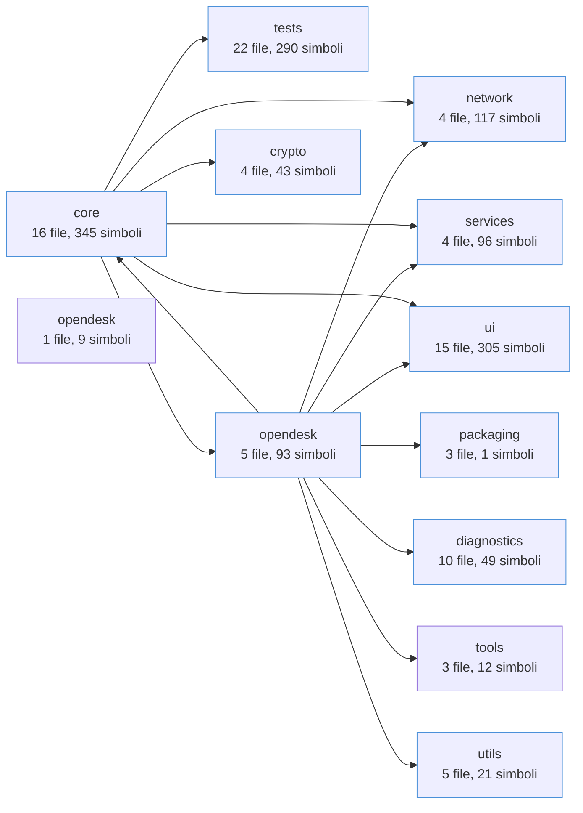

# Schema Codebase

> Generato automaticamente dall'estensione `codebase-mapper`.

## Panoramica

- **File sorgente**: 92
- **Righe totali**: 28.476
- **Linguaggi**: python (92)
- **Moduli**: 12

## Funzionalità per modulo

| Modulo | Percorso | File | Simboli | Entry point |
|---|---|---|---|---|
| tests | `tests` | 22 | 290 | test_tier_zero_when_screen_moves, test_tier_escalates_when_idle_and_cpu_free, test_busy_cpu_suppresses_boost, test_unknown_cpu_load_stays_conservative, test_preset_ladder_moves_slower_and_clamps |
| core | `opendesk/core` | 16 | 345 | main, on_error, on_eos, run_full_benchmark, auto_tune_encoder |
| ui | `opendesk/ui` | 15 | 305 | flash_button |
| diagnostics | `tools/diagnostics` | 10 | 49 | main, drain, collect_windows, cb, main |
| opendesk | `opendesk` | 5 | 93 | load_stylesheet, toggle_theme, get_current_theme, main_release, install_system_deps |
| utils | `opendesk/utils` | 5 | 21 | parse_log_level, setup_logging, current_platform, platform_name, is_wayland |
| crypto | `opendesk/crypto` | 4 | 43 | hash_password, verify_password, needs_rehash, generate_session_id, generate_otp |
| network | `opendesk/network` | 4 | 117 | - |
| services | `opendesk/services` | 4 | 96 | - |
| packaging | `packaging` | 3 | 1 | main |
| tools | `tools` | 3 | 12 | measure, main, find_opendesk_host_process, thread_cpu_pct, main |
| opendesk | `(root)` | 1 | 9 | detect_platform, install_system_deps_windows, install_system_deps_linux, install_system_deps_darwin, install_opendesk |

## Oggetti (classi, interfacce, entità)

| Nome | Tipo | File | Riga |
|---|---|---|---|
| AudioDirection | class | `opendesk/core/audio_manager.py` | 39 |
| AudioConfig | class | `opendesk/core/audio_manager.py` | 49 |
| OpusCodec | class | `opendesk/core/audio_manager.py` | 64 |
| AudioManager | class | `opendesk/core/audio_manager.py` | 193 |
| EncoderBenchResult | class | `opendesk/core/benchmark.py` | 40 |
| BenchmarkReport | class | `opendesk/core/benchmark.py` | 60 |
| CameraState | class | `opendesk/core/camera_manager.py` | 44 |
| CameraConfig | class | `opendesk/core/camera_manager.py` | 54 |
| CameraManager | class | `opendesk/core/camera_manager.py` | 147 |
| ClipboardSync | class | `opendesk/core/clipboard_sync.py` | 41 |
| DeviceEntry | class | `opendesk/core/device_registry.py` | 26 |
| DeviceRegistry | class | `opendesk/core/device_registry.py` | 48 |
| TransferDirection | class | `opendesk/core/file_transfer.py` | 75 |
| TransferState | class | `opendesk/core/file_transfer.py` | 80 |
| FileInfo | class | `opendesk/core/file_transfer.py` | 91 |
| TransferJob | class | `opendesk/core/file_transfer.py` | 113 |
| _ReceiveTarget | class | `opendesk/core/file_transfer.py` | 131 |
| _BgEventLoop | class | `opendesk/core/file_transfer.py` | 143 |
| FileTransferManager | class | `opendesk/core/file_transfer.py` | 197 |
| MouseButton | class | `opendesk/core/input_injection.py` | 40 |
| KeyState | class | `opendesk/core/input_injection.py` | 48 |
| MouseEvent | class | `opendesk/core/input_injection.py` | 55 |
| KeyboardEvent | class | `opendesk/core/input_injection.py` | 64 |
| InputBackend | class | `opendesk/core/input_injection.py` | 75 |
| X11InputBackend | class | `opendesk/core/input_injection.py` | 119 |
| WaylandInputBackend | class | `opendesk/core/input_injection.py` | 273 |
| _MOUSEINPUT | class | `opendesk/core/input_injection.py` | 799 |
| HealthSeverity | class | `opendesk/core/platform_config.py` | 41 |
| HealthIssue | class | `opendesk/core/platform_config.py` | 48 |
| CaptureMethod | class | `opendesk/core/platform_config.py` | 73 |
| PlatformConfig | class | `opendesk/core/platform_config.py` | 187 |
| MonitorInfo | class | `opendesk/core/screen_capture.py` | 42 |
| CapturedFrame | class | `opendesk/core/screen_capture.py` | 59 |
| PipeWireCapture | class | `opendesk/core/screen_capture.py` | 140 |
| ScreenCapture | class | `opendesk/core/screen_capture.py` | 506 |
| CURSORINFO | class | `opendesk/core/screen_capture.py` | 1024 |
| ICONINFO | class | `opendesk/core/screen_capture.py` | 1056 |
| BITMAPINFOHEADER | class | `opendesk/core/screen_capture.py` | 1065 |
| BITMAP | class | `opendesk/core/screen_capture.py` | 1093 |
| RecordingStatus | class | `opendesk/core/screen_recorder.py` | 28 |
| ScreenRecorder | class | `opendesk/core/screen_recorder.py` | 45 |
| UnattendedConfig | class | `opendesk/core/unattended.py` | 24 |
| UnattendedAccess | class | `opendesk/core/unattended.py` | 37 |
| QualityLevel | class | `opendesk/core/video_codec.py` | 94 |
| EncoderConfig | class | `opendesk/core/video_codec.py` | 143 |
| EncodedPacket | class | `opendesk/core/video_codec.py` | 184 |
| VideoEncoder | class | `opendesk/core/video_codec.py` | 200 |
| VideoDecoder | class | `opendesk/core/video_codec.py` | 573 |
| WaylandCaptureSession | class | `opendesk/core/wayland_capture.py` | 70 |
| WaylandScreenCast | class | `opendesk/core/wayland_capture.py` | 80 |
| StoredCredential | class | `opendesk/crypto/auth.py` | 128 |
| PendingSession | class | `opendesk/crypto/auth.py` | 138 |
| AuthManager | class | `opendesk/crypto/auth.py` | 152 |
| CryptoKeyPair | class | `opendesk/crypto/e2ee.py` | 36 |
| EncryptedMessage | class | `opendesk/crypto/e2ee.py` | 87 |
| E2EEncryption | class | `opendesk/crypto/e2ee.py` | 115 |
| HostService | class | `opendesk/host_app.py` | 67 |
| HostWindow | class | `opendesk/host_app.py` | 576 |
| _PROCESSENTRY32 | class | `opendesk/host_service.py` | 55 |
| _SERVICE_STATUS | class | `opendesk/host_service.py` | 168 |
| _SERVICE_TABLE_ENTRY | class | `opendesk/host_service.py` | 180 |
| P2PTransport | class | `opendesk/network/p2p_transport.py` | 73 |
| MessageType | class | `opendesk/network/protocol.py` | 40 |
| Message | class | `opendesk/network/protocol.py` | 121 |
| RelayRole | class | `opendesk/network/relay_client.py` | 72 |
| _RelaySession | class | `opendesk/network/relay_client.py` | 111 |
| RelayClient | class | `opendesk/network/relay_client.py` | 1483 |
| ConnectionService | class | `opendesk/services/connection_service.py` | 36 |
| PipelineConfig | class | `opendesk/services/pipeline.py` | 138 |
| CaptureWorker | class | `opendesk/services/pipeline.py` | 185 |
| EncoderWorker | class | `opendesk/services/pipeline.py` | 355 |
| NetworkWorker | class | `opendesk/services/pipeline.py` | 847 |
| StreamingPipeline | class | `opendesk/services/pipeline.py` | 908 |
| InputInjectionWorker | class | `opendesk/services/stream_service.py` | 86 |
| StreamService | class | `opendesk/services/stream_service.py` | 159 |
| ChatPanel | class | `opendesk/ui/chat_panel.py` | 27 |
| DeviceListModel | class | `opendesk/ui/connections.py` | 54 |
| DeviceDelegate | class | `opendesk/ui/connections.py` | 138 |
| ConnectionPanel | class | `opendesk/ui/connections.py` | 268 |
| SessionStatusWidget | class | `opendesk/ui/connections.py` | 537 |
| RemoteFileSystemModel | class | `opendesk/ui/file_transfer_ui.py` | 83 |
| TransferListModel | class | `opendesk/ui/file_transfer_ui.py` | 271 |
| TransferDelegate | class | `opendesk/ui/file_transfer_ui.py` | 426 |
| FileBrowserDock | class | `opendesk/ui/file_transfer_ui.py` | 623 |
| MainWindow | class | `opendesk/ui/main_window.py` | 51 |
| MonitorSelector | class | `opendesk/ui/monitor_selector.py` | 29 |
| SessionInfoWidget | class | `opendesk/ui/session_info.py` | 31 |
| SettingsDialog | class | `opendesk/ui/settings_dialog.py` | 45 |
| _RecordingWorker | class | `opendesk/ui/viewer.py` | 85 |
| CameraOverlay | class | `opendesk/ui/viewer.py` | 137 |
| RemoteViewer | class | `opendesk/ui/viewer.py` | 243 |
| FitMode | class | `opendesk/ui/viewer.py` | 267 |
| ViewerToolbar | class | `opendesk/ui/viewer.py` | 942 |
| ViewerWindow | class | `opendesk/ui/viewer.py` | 1094 |
| EmptyStateWidget | class | `opendesk/ui/widgets/empty_state_widget.py` | 14 |
| HealthStatusWidget | class | `opendesk/ui/widgets/health_status.py` | 16 |
| HealthSummaryDialog | class | `opendesk/ui/widgets/health_status.py` | 93 |
| StatusBadge | class | `opendesk/ui/widgets/status_badge.py` | 22 |
| ToastNotification | class | `opendesk/ui/widgets/toast_notification.py` | 18 |
| Type | class | `opendesk/ui/widgets/toast_notification.py` | 27 |
| _TaskSignals | class | `opendesk/utils/async_task.py` | 26 |
| HangWatchdog | class | `opendesk/utils/hang_watchdog.py` | 103 |
| Platform | class | `opendesk/utils/platform.py` | 17 |
| _FileTime | class | `opendesk/utils/platform.py` | 75 |
| TestFileTransferManager | class | `tests/test_advanced.py` | 25 |
| TestClipboardSync | class | `tests/test_advanced.py` | 189 |
| TestUnattendedAccess | class | `tests/test_advanced.py` | 220 |
| TestInputBackend | class | `tests/test_advanced.py` | 333 |
| TestCaptureBackend | class | `tests/test_advanced.py` | 365 |
| TestRunAsync | class | `tests/test_async_task.py` | 32 |
| TestSessionHashFlow | class | `tests/test_async_task.py` | 89 |
| TestFrameDifferencing | class | `tests/test_capture.py` | 14 |
| TestVideoCodec | class | `tests/test_capture.py` | 54 |
| TestInputInjection | class | `tests/test_capture.py` | 147 |
| TestE2EEncryption | class | `tests/test_crypto.py` | 19 |
| TestPasswordHashing | class | `tests/test_crypto.py` | 211 |
| FakeBackend | class | `tests/test_input_worker.py` | 37 |
| TestInputInjectionWorker | class | `tests/test_input_worker.py` | 77 |
| TestStreamServiceInputOffMainThread | class | `tests/test_input_worker.py` | 150 |
| TestClipboardBackoff | class | `tests/test_input_worker.py` | 206 |
| SlowMime | class | `tests/test_input_worker.py` | 219 |
| SimulatedPeer | class | `tests/test_integration.py` | 23 |
| TestP2PIntegration | class | `tests/test_integration.py` | 67 |
| TestKeyToEvdev | class | `tests/test_keyboard.py` | 34 |
| TestVkFromKey | class | `tests/test_keyboard.py` | 106 |
| TestKeyToName | class | `tests/test_keyboard.py` | 164 |
| TestCapsLockStateMessage | class | `tests/test_keyboard.py` | 208 |
| TestProtocol | class | `tests/test_network.py` | 10 |
| _FakeHelper | class | `tests/test_preencoded_capture.py` | 21 |
| TestPacketFraming | class | `tests/test_preencoded_capture.py` | 44 |
| TestPipelinePassthrough | class | `tests/test_preencoded_capture.py` | 72 |
| TestProtocolEdgeCases | class | `tests/test_protocol_edge.py` | 21 |
| TestScreenRecorder | class | `tests/test_recording.py` | 14 |
| TestWaylandCapture | class | `tests/test_recording.py` | 93 |
| _PairedRelay | class | `tests/test_relay_integration.py` | 32 |
| TestRelayHandshake | class | `tests/test_relay_integration.py` | 155 |
| _ScriptedRelay | class | `tests/test_relay_roles.py` | 25 |
| _Session | class | `tests/test_relay_roles.py` | 120 |
| TestSessionInfoWidget | class | `tests/test_ui.py` | 35 |
| TestEmptyStateWidget | class | `tests/test_ui.py` | 91 |
| TestStatusBadge | class | `tests/test_ui.py` | 149 |
| TestChatPanel | class | `tests/test_ui.py` | 184 |
| TestToastNotification | class | `tests/test_ui.py` | 242 |
| TestChallengeResponse | class | `tests/test_ui.py` | 267 |
| TestViewerToolbar | class | `tests/test_ui.py` | 316 |
| TestAuthSessionCleanup | class | `tests/test_ui.py` | 354 |

## Diagramma di flusso tra moduli

## Diagramma classi/entità (principale)

```mermaid
classDiagram
  class AudioDirection {
    <<class>>
  }
  class AudioConfig {
    <<class>>
  }
  class OpusCodec {
    <<class>>
  }
  class AudioManager {
    <<class>>
  }
  class EncoderBenchResult {
    <<class>>
  }
  class BenchmarkReport {
    <<class>>
  }
  class CameraState {
    <<class>>
  }
  class CameraConfig {
    <<class>>
  }
  class CameraManager {
    <<class>>
  }
  class ClipboardSync {
    <<class>>
  }
  class DeviceEntry {
    <<class>>
  }
  class DeviceRegistry {
    <<class>>
  }
  class TransferDirection {
    <<class>>
  }
  class TransferState {
    <<class>>
  }
  class FileInfo {
    <<class>>
  }
  class TransferJob {
    <<class>>
  }
  class _ReceiveTarget {
    <<class>>
  }
  class _BgEventLoop {
    <<class>>
  }
  class FileTransferManager {
    <<class>>
  }
  class MouseButton {
    <<class>>
  }
  class KeyState {
    <<class>>
  }
  class MouseEvent {
    <<class>>
  }
  class KeyboardEvent {
    <<class>>
  }
  class InputBackend {
    <<class>>
  }
  class X11InputBackend {
    <<class>>
  }
  class WaylandInputBackend {
    <<class>>
  }
  class _MOUSEINPUT {
    <<class>>
  }
  class _KEYBDINPUT {
    <<class>>
  }
  class _HARDWAREINPUT {
    <<class>>
  }
  class _INPUT_UNION {
    <<class>>
  }
  class _INPUT {
    <<class>>
  }
  class WindowsInputBackend {
    <<class>>
  }
  class MacOSInputBackend {
    <<class>>
  }
  HealthSeverity --> WaylandInputBackend : uses
  HealthIssue --> WaylandInputBackend : uses
  CaptureMethod --> WaylandInputBackend : uses
  PlatformConfig --> WaylandInputBackend : uses
  HealthSeverity --> X11InputBackend : uses
  HealthIssue --> X11InputBackend : uses
  CaptureMethod --> X11InputBackend : uses
  PlatformConfig --> X11InputBackend : uses
  HealthSeverity --> WindowsInputBackend : uses
  HealthIssue --> WindowsInputBackend : uses
  CaptureMethod --> WindowsInputBackend : uses
  PlatformConfig --> WindowsInputBackend : uses
  HealthSeverity --> MacOSInputBackend : uses
  HealthIssue --> MacOSInputBackend : uses
  CaptureMethod --> MacOSInputBackend : uses
  PlatformConfig --> MacOSInputBackend : uses
  HostService --> FileTransferManager : uses
  HostWindow --> FileTransferManager : uses
  HostService --> ClipboardSync : uses
  HostWindow --> ClipboardSync : uses
  HostService --> DeviceRegistry : uses
  HostWindow --> DeviceRegistry : uses
  ConnectionService --> DeviceRegistry : uses
  InputInjectionWorker --> InputBackend : uses
  StreamService --> InputBackend : uses
  InputInjectionWorker --> AudioManager : uses
  StreamService --> AudioManager : uses
  InputInjectionWorker --> AudioConfig : uses
  StreamService --> AudioConfig : uses
  InputInjectionWorker --> CameraManager : uses
  StreamService --> CameraManager : uses
  InputInjectionWorker --> CameraConfig : uses
  StreamService --> CameraConfig : uses
  InputInjectionWorker --> MouseButton : uses
  StreamService --> MouseButton : uses
  MainWindow --> FileTransferManager : uses
  MainWindow --> ClipboardSync : uses
  TestFileTransferManager --> FileInfo : uses
  TestClipboardSync --> FileInfo : uses
  TestUnattendedAccess --> FileInfo : uses
  TestInputBackend --> FileInfo : uses
  TestCaptureBackend --> FileInfo : uses
  TestFileTransferManager --> FileTransferManager : uses
  TestClipboardSync --> FileTransferManager : uses
  TestUnattendedAccess --> FileTransferManager : uses
  TestInputBackend --> FileTransferManager : uses
  TestCaptureBackend --> FileTransferManager : uses
  TestFileTransferManager --> ClipboardSync : uses
  TestClipboardSync --> ClipboardSync : uses
  TestUnattendedAccess --> ClipboardSync : uses
  TestInputBackend --> ClipboardSync : uses
  TestCaptureBackend --> ClipboardSync : uses
  FakeBackend --> ClipboardSync : uses
  TestInputInjectionWorker --> ClipboardSync : uses
  TestStreamServiceInputOffMainThread --> ClipboardSync : uses
  TestClipboardBackoff --> ClipboardSync : uses
  SlowMime --> ClipboardSync : uses
```

## Diagrammi di flusso per modulo

### tests

### core

```mermaid
flowchart TD
  n0 --> n1
  n0 --> n2
  n0 --> n3
  n0 --> n4
  n0 --> n5
  n0 --> n6
  n0 --> n7
  n0 --> n8
  n0 --> n9
  n10 --> n11
  n10 --> n12
  n10 --> n13
  n10 --> n14
  n10 --> n15
  n10 --> n16
  n10 --> n17
  n10 --> n18
  n10 --> n19
  n10 --> n20
  n10 --> n21
  n10 --> n22
  n10 --> n23
  n10 --> n24
  n10 --> n25
  n26 --> n14
  n26 --> n17
  n26 --> n27
  n26 --> n28
  n26 --> n29
  n26 --> n30
  n26 --> n31
  n26 --> n32
  n33 --> n11
  n33 --> n2
  n33 --> n34
  n33 --> n35
  n33 --> n17
  n33 --> n12
  n33 --> n18
  n33 --> n36
  n33 --> n20
  n33 --> n37
  n33 --> n21
  n33 --> n22
  n33 --> n38
  n33 --> n23
  n39 --> n2
  n39 --> n3
  n39 --> n4
  n39 --> n12
  n39 --> n40
  n39 --> n11
  n39 --> n41
  n39 --> n38
  n39 --> n42
  n39 --> n43
  n39 --> n44
  n45 --> n46
  n45 --> n12
  n45 --> n47
  n0["_pipewire_helper"]
  n1["find"]
  n2["get"]
  n3["width"]
  n4["height"]
  n5["flush"]
  n6["_pick_encoder"]
  n7["main"]
  n8["on_error"]
  n9["on_eos"]
  n10["audio_manager"]
  n11["start"]
  n12["__init__"]
  n13["setup_encoder"]
  n14["encode"]
  n15["setup_decoder"]
  n16["decode"]
  n17["release"]
  n18["config"]
  n19["direction"]
  n20["is_capturing"]
  n21["start_capture"]
  n22["stop_capture"]
  n23["_capture_loop"]
  n24["play_audio_frame"]
  n25["_play_blocking"]
  n26["benchmark"]
  n27["set_quality"]
  n28["efficiency"]
  n29["summary"]
  n30["_generate_test_pattern"]
  n31["run_full_benchmark"]
  n32["auto_tune_encoder"]
  n33["camera_manager"]
  n34["list_cameras"]
  n35["_suppress_opencv_stderr"]
  n36["state"]
  n37["actual_resolution"]
  n38["toggle"]
  n39["clipboard_sync"]
  n40["enabled"]
  n41["stop"]
  n42["receive_from_remote"]
  n43["_apply_backoff"]
  n44["_poll_clipboard"]
  n45["device_registry"]
  n46["online"]
  n47["_load"]
```

### ui

### diagnostics

```mermaid
flowchart TD
  n0 --> n1
  n0 --> n2
  n3 --> n4
  n3 --> n5
  n3 --> n1
  n6 --> n7
  n6 --> n5
  n6 --> n1
  n8 --> n1
  n8 --> n9
  n8 --> n10
  n11 --> n1
  n11 --> n9
  n11 --> n12
  n11 --> n13
  n14 --> n15
  n14 --> n1
  n16 --> n15
  n16 --> n9
  n16 --> n17
  n16 --> n18
  n16 --> n19
  n16 --> n1
  n20 --> n1
  n20 --> n9
  n20 --> n12
  n21 --> n22
  n21 --> n23
  n21 --> n1
  n21 --> n9
  n21 --> n24
  n21 --> n25
  n21 --> n26
  n21 --> n27
  n21 --> n28
  n21 --> n29
  n21 --> n30
  n21 --> n31
  n21 --> n32
  n21 --> n33
  n34 --> n35
  n34 --> n36
  n34 --> n37
  n34 --> n38
  n34 --> n39
  n34 --> n1
  n34 --> n40
  n34 --> n41
  n34 --> n27
  n0["debug_client_load"]
  n1["main"]
  n2["drain"]
  n3["debug_window_churn"]
  n4["collect_windows"]
  n5["cb"]
  n6["probe_host_window"]
  n7["find_host_window"]
  n8["repro_av_gil"]
  n9["beat"]
  n10["encode_loop"]
  n11["repro_bitblt_win32k"]
  n12["grab_loop"]
  n13["window_churn"]
  n14["repro_captureblt"]
  n15["measure"]
  n16["repro_gil_starvation"]
  n17["runner"]
  n18["dxcam_loop"]
  n19["idle_loop"]
  n20["repro_mss_gil"]
  n21["repro_session_ui_stall"]
  n22["_dump_on_stall"]
  n23["_sample_loop"]
  n24["wrap_send"]
  n25["counting_frame"]
  n26["counting_tile"]
  n27["run_phase"]
  n28["do_minimize"]
  n29["do_restore"]
  n30["input_flood"]
  n31["flood_loop"]
  n32["do_close"]
  n33["do_reshow"]
  n34["repro_window_close_freeze"]
  n35["beat_loop"]
  n36["_beat"]
  n37["make_window"]
  n38["win32_minimize"]
  n39["win32_close"]
  n40["fake_tile"]
  n41["flood"]
```

### opendesk

### utils

```mermaid
flowchart TD
  n0 --> n1
  n0 --> n2
  n0 --> n3
  n4 --> n5
  n4 --> n6
  n4 --> n7
  n4 --> n8
  n4 --> n9
  n10 --> n11
  n10 --> n12
  n10 --> n13
  n14 --> n15
  n14 --> n16
  n14 --> n17
  n14 --> n18
  n14 --> n19
  n14 --> n20
  n0["async_task"]
  n1["_deliver_done"]
  n2["_deliver_error"]
  n3["_worker"]
  n4["hang_watchdog"]
  n5["_log_thread_stacks"]
  n6["_find_pyspy"]
  n7["_log_native_stack"]
  n8["_beat"]
  n9["_run"]
  n10["logger"]
  n11["parse_log_level"]
  n12["_log_directory"]
  n13["setup_logging"]
  n14["platform"]
  n15["current_platform"]
  n16["platform_name"]
  n17["is_wayland"]
  n18["_windows_cpu_load"]
  n19["_value"]
  n20["cpu_load_percent"]
```

## Dettaglio simboli per file

**cross_platform_installer.py** (python, 248 righe)

- `detect_platform` — function @29: `def detect_platform() -> platform.system():`
- `install_system_deps_windows` — function @53: `def install_system_deps_windows() -> None:`
- `install_system_deps_linux` — function @61: `def install_system_deps_linux() -> None:`
- `install_system_deps_darwin` — function @102: `def install_system_deps_darwin() -> None:`
- `install_opendesk` — function @108: `def install_opendesk() -> None:`
- `_shutil_which` — function @123: `def _shutil_which(name: str) -> str | None:`
- `setup_host_app` — function @130: `def setup_host_app() -> None:`
- `setup_autostart` — function @163: `def setup_autostart() -> None:`
- `main` — function @192: `def main() -> None:`

**opendesk/__init__.py** (python, 11 righe)

**opendesk/__main__.py** (python, 9 righe)

**opendesk/app.py** (python, 321 righe)

- `_apply_palette` — function @80: `def _apply_palette(app: QApplication, theme: str) -> None:`
- `load_stylesheet` — function @89: `def load_stylesheet(app: QApplication, theme: str = "light") -> None:`
- `toggle_theme` — function @108: `def toggle_theme(app: QApplication) -> str:`
- `get_current_theme` — function @118: `def get_current_theme() -> str:`
- `main_release` — function @123: `def main_release() -> None:`
- `install_system_deps` — function @128: `def install_system_deps() -> None:`
- `_ensure_desktop_entry` — function @183: `def _ensure_desktop_entry() -> None:`
- `_parse_cli_args` — function @228: `def _parse_cli_args() -> tuple[list[str], str | None, str | None]:`
- `main` — function @260: `def main(log_level: int | None = None) -> None:`

**opendesk/core/__init__.py** (python, 2 righe)

**opendesk/core/_pipewire_helper.py** (python, 238 righe)

- `_pick_encoder` — function @56: `def _pick_encoder(requested: str) -> tuple[str, str] | None:`
- `main` — function @65: `def main() -> None:`
- `on_error` — function @156: `def on_error(bus, message) -> None:`
- `on_eos` — function @162: `def on_eos(bus, message) -> None:`

**opendesk/core/audio_manager.py** (python, 415 righe)

- `AudioDirection` — class @39: `class AudioDirection(Enum):`
- `AudioConfig` — class @49: `class AudioConfig:`
- `OpusCodec` — class @64: `class OpusCodec:`
- `__init__` — method @71: `def __init__(self, sample_rate: int = _SAMPLE_RATE, channels: int = _CHANNELS) -> None:`
- `setup_encoder` — method @80: `def setup_encoder(self) -> None:`
- `encode` — method @97: `def encode(self, pcm: np.ndarray) -> bytes | None:`
- `setup_decoder` — method @128: `def setup_decoder(self) -> None:`
- `decode` — method @139: `def decode(self, data: bytes) -> np.ndarray | None:`
- `release` — method @176: `def release(self) -> None:`
- `AudioManager` — class @193: `class AudioManager:`

**opendesk/core/benchmark.py** (python, 275 righe)

- `EncoderBenchResult` — class @40: `class EncoderBenchResult:`
- `efficiency` — method @54: `def efficiency(self) -> float:`
- `BenchmarkReport` — class @60: `class BenchmarkReport:`
- `summary` — method @70: `def summary(self) -> str:`
- `_generate_test_pattern` — function @91: `def _generate_test_pattern(width: int, height: int, frame_num: int) -> np.ndarray:`
- `run_full_benchmark` — function @196: `def run_full_benchmark() -> BenchmarkReport:`
- `auto_tune_encoder` — function @255: `def auto_tune_encoder(encoder: VideoEncoder, report: BenchmarkReport | None = None) -> Non`

**opendesk/core/camera_manager.py** (python, 344 righe)

- `CameraState` — class @44: `class CameraState(Enum):`
- `CameraConfig` — class @54: `class CameraConfig:`
- `list_cameras` — function @70: `def list_cameras(max_devices: int = 10) -> list[dict]:`
- `_suppress_opencv_stderr` — function @124: `def _suppress_opencv_stderr():`
- `CameraManager` — class @147: `class CameraManager:`
- `__init__` — method @158: `def __init__(self, config: CameraConfig | None = None) -> None:`
- `config` — method @174: `def config(self) -> CameraConfig:`
- `state` — method @178: `def state(self) -> CameraState:`
- `is_capturing` — method @182: `def is_capturing(self) -> bool:`
- `actual_resolution` — method @186: `def actual_resolution(self) -> tuple[int, int]:`

**opendesk/core/clipboard_sync.py** (python, 247 righe)

- `ClipboardSync` — class @41: `class ClipboardSync(QObject):`
- `__init__` — method @58: `def __init__(self, parent: QObject | None = None) -> None:`
- `enabled` — method @78: `def enabled(self) -> bool:`
- `start` — method @81: `def start(self, send_fn) -> None:`
- `stop` — method @97: `def stop(self) -> None:`
- `toggle` — method @104: `def toggle(self) -> bool:`
- `receive_from_remote` — method @113: `def receive_from_remote(self, msg: Message) -> None:`
- `_apply_backoff` — method @160: `def _apply_backoff(self) -> None:`
- `_poll_clipboard` — method @178: `def _poll_clipboard(self) -> None:`

**opendesk/core/device_registry.py** (python, 287 righe)

- `DeviceEntry` — class @26: `class DeviceEntry:`
- `DeviceRegistry` — class @48: `class DeviceRegistry:`
- `__init__` — method @54: `def __init__(self, path: Path | None = None) -> None:`
- `get` — method @61: `def get(self, device_id: str) -> DeviceEntry | None:`
- `all` — method @65: `def all(self) -> list[DeviceEntry]:`
- `online` — method @73: `def online(self) -> list[DeviceEntry]:`
- `trusted` — method @77: `def trusted(self) -> list[DeviceEntry]:`
- `is_trusted` — method @81: `def is_trusted(self, device_id: str) -> bool:`
- `find` — method @86: `def find(self, query: str) -> list[DeviceEntry]:`
- `upsert` — method @128: `def upsert(self, device_id: str, *, _save: bool = True, **kwargs: Any) -> DeviceEntry:`

**opendesk/core/file_transfer.py** (python, 886 righe)

- `TransferDirection` — class @75: `class TransferDirection(Enum):`
- `TransferState` — class @80: `class TransferState(Enum):`
- `FileInfo` — class @91: `class FileInfo:`
- `from_path` — method @101: `def from_path(cls, path: str | Path) -> FileInfo:`
- `TransferJob` — class @113: `class TransferJob:`
- `_ReceiveTarget` — class @131: `class _ReceiveTarget:`
- `_BgEventLoop` — class @143: `class _BgEventLoop:`
- `__init__` — method @151: `def __init__(self) -> None:`
- `start` — method @155: `def start(self) -> None:`
- `stop` — method @168: `def stop(self) -> None:`

**opendesk/core/input_injection.py** (python, 1379 righe)

- `MouseButton` — class @40: `class MouseButton(IntEnum):`
- `KeyState` — class @48: `class KeyState(IntEnum):`
- `MouseEvent` — class @55: `class MouseEvent:`
- `KeyboardEvent` — class @64: `class KeyboardEvent:`
- `InputBackend` — class @75: `class InputBackend(ABC):`
- `move_mouse` — method @79: `def move_mouse(self, x: int, y: int, absolute: bool = True) -> None: ...`
- `click_mouse` — method @82: `def click_mouse(self, button: MouseButton, state: KeyState) -> None: ...`
- `scroll_mouse` — method @85: `def scroll_mouse(self, dx: int, dy: int) -> None: ...`
- `key_event` — method @88: `def key_event(self, key: str | int, state: KeyState) -> None: ...`
- `type_text` — method @91: `def type_text(self, text: str) -> None: ...`

**opendesk/core/keyboard_state.py** (python, 155 righe)

- `_check_x11` — function @27: `def _check_x11() -> bool:`
- `_check_sys_leds` — function @53: `def _check_sys_leds() -> bool:`
- `_check_win32` — function @75: `def _check_win32() -> bool:`
- `_check_subprocess` — function @86: `def _check_subprocess() -> bool:`
- `_init_checker` — function @103: `def _init_checker() -> _Checker:`
- `caps_lock_active` — function @143: `def caps_lock_active() -> bool:`

**opendesk/core/platform_config.py** (python, 846 righe)

- `HealthSeverity` — class @41: `class HealthSeverity(Enum):`
- `HealthIssue` — class @48: `class HealthIssue:`
- `__str__` — method @56: `def __str__(self) -> str:`
- `CaptureMethod` — class @73: `class CaptureMethod(Enum):`
- `_find_system_python_gi` — function @89: `def _find_system_python_gi() -> str | None:`
- `_check_dxcam` — function @121: `def _check_dxcam() -> bool:`
- `_check_pipewire_element` — function @131: `def _check_pipewire_element() -> bool:`
- `_check_portal_available` — function @156: `def _check_portal_available() -> bool:`
- `_check_x11_display` — function @176: `def _check_x11_display() -> bool:`
- `PlatformConfig` — class @187: `class PlatformConfig:`

**opendesk/core/screen_capture.py** (python, 1236 righe)

- `MonitorInfo` — class @42: `class MonitorInfo:`
- `size` — method @54: `def size(self) -> tuple[int, int]:`
- `CapturedFrame` — class @59: `class CapturedFrame:`
- `width` — method @68: `def width(self) -> int:`
- `height` — method @72: `def height(self) -> int:`
- `PipeWireCapture` — class @140: `class PipeWireCapture:`
- `__init__` — method @153: `def __init__(self) -> None:`
- `is_available` — method @170: `def is_available(self) -> bool:`
- `start` — method @213: `def start(self, monitor_index: int = 0) -> None:`
- `capture_one` — method @264: `def capture_one(self, monitor_index: int = 0) -> CapturedFrame | None:`

**opendesk/core/screen_recorder.py** (python, 231 righe)

- `RecordingStatus` — class @28: `class RecordingStatus:`
- `elapsed` — method @39: `def elapsed(self) -> float:`
- `ScreenRecorder` — class @45: `class ScreenRecorder:`
- `__init__` — method @57: `def __init__(self, output_dir: str | Path | None = None) -> None:`
- `status` — method @69: `def status(self) -> RecordingStatus:`
- `is_recording` — method @73: `def is_recording(self) -> bool:`
- `write_frame` — method @146: `def write_frame(self, rgb_data: np.ndarray) -> bool:`
- `stop` — method @179: `def stop(self) -> RecordingStatus:`
- `cancel` — method @223: `def cancel(self) -> None:`

**opendesk/core/unattended.py** (python, 218 righe)

- `UnattendedConfig` — class @24: `class UnattendedConfig:`
- `UnattendedAccess` — class @37: `class UnattendedAccess:`
- `__init__` — method @54: `def __init__(self, config_path: str | Path | None = None) -> None:`
- `enabled` — method @62: `def enabled(self) -> bool:`
- `session_id` — method @66: `def session_id(self) -> str:`
- `config` — method @70: `def config(self) -> UnattendedConfig:`
- `enable` — method @75: `def enable(self, password: str, auto_accept: bool = True) -> None:`
- `disable` — method @95: `def disable(self) -> None:`
- `enable_allowlist_only` — method @103: `def enable_allowlist_only(self) -> None:`
- `set_master_password` — method @117: `def set_master_password(self, password: str) -> None:`

**opendesk/core/video_codec.py** (python, 737 righe)

- `_candidates` — function @29: `def _candidates(prefer_hw: bool = True) -> list[str]:`
- `_try_open_codec` — function @58: `def _try_open_codec(name: str, fps: int = 30) -> bool:`
- `QualityLevel` — class @94: `class QualityLevel(Enum):`
- `EncoderConfig` — class @143: `class EncoderConfig:`
- `EncodedPacket` — class @184: `class EncodedPacket:`
- `VideoEncoder` — class @200: `class VideoEncoder:`
- `__init__` — method @210: `def __init__(self, config: EncoderConfig | None = None) -> None:`
- `config` — method @225: `def config(self) -> EncoderConfig:`
- `codec_name` — method @229: `def codec_name(self) -> str:`
- `actual_bitrate` — method @234: `def actual_bitrate(self) -> int:`

**opendesk/core/wayland_capture.py** (python, 667 righe)

- `_read_exact` — function @43: `def _read_exact(stream, n: int, timeout: float = 30.0) -> bytes | None:`
- `WaylandCaptureSession` — class @70: `class WaylandCaptureSession:`
- `WaylandScreenCast` — class @80: `class WaylandScreenCast:`
- `__init__` — method @93: `def __init__(self, encoded: bool = False, encoder: str = "auto") -> None:`
- `is_available` — method @111: `def is_available(self) -> bool:`
- `setup` — method @157: `async def setup(self) -> bool:`
- `capture_frame` — method @176: `async def capture_frame(self) -> np.ndarray | None:`
- `encoded` — method @191: `def encoded(self) -> bool:`
- `helper_alive` — method @196: `def helper_alive(self) -> bool:`
- `capture_packet_sync` — method @201: `def capture_packet_sync(self) -> tuple[bytes, bool] | None:`

**opendesk/crypto/__init__.py** (python, 2 righe)

**opendesk/crypto/auth.py** (python, 393 righe)

- `hash_password` — function @56: `def hash_password(password: str) -> str:`
- `verify_password` — function @67: `def verify_password(password: str, hash_str: str) -> bool:`
- `needs_rehash` — function @81: `def needs_rehash(hash_str: str) -> bool:`
- `generate_session_id` — function @94: `def generate_session_id() -> str:`
- `generate_otp` — function @110: `def generate_otp() -> str:`
- `StoredCredential` — class @128: `class StoredCredential:`
- `PendingSession` — class @138: `class PendingSession:`
- `AuthManager` — class @152: `class AuthManager:`
- `__init__` — method @162: `def __init__(self, config_path: str | Path | None = None) -> None:`
- `set_password` — method @172: `def set_password(self, username: str, password: str) -> None:`

**opendesk/crypto/challenge.py** (python, 75 righe)

- `generate_nonce` — function @23: `def generate_nonce() -> str:`
- `compute_response` — function @34: `def compute_response(nonce: str, password: str) -> str:`
- `verify_response` — function @54: `def verify_response(nonce: str, password: str, response: str) -> bool:`

**opendesk/crypto/e2ee.py** (python, 252 righe)

- `CryptoKeyPair` — class @36: `class CryptoKeyPair:`
- `generate` — method @43: `def generate(cls) -> CryptoKeyPair:`
- `from_private_bytes` — method @49: `def from_private_bytes(cls, data: bytes) -> CryptoKeyPair:`
- `private_bytes` — method @55: `def private_bytes(self) -> bytes:`
- `public_bytes` — method @59: `def public_bytes(self) -> bytes:`
- `encode_public` — method @62: `def encode_public(self) -> str:`
- `decode_public` — method @72: `def decode_public(cls, encoded: str) -> PublicKey:`
- `EncryptedMessage` — class @87: `class EncryptedMessage:`
- `encode` — method @94: `def encode(self) -> bytes:`
- `decode` — method @105: `def decode(cls, data: bytes) -> EncryptedMessage:`

**opendesk/host_app.py** (python, 1310 righe)

- `HostService` — class @67: `class HostService(QObject):`
- `__init__` — method @99: `def __init__(self, parent: QObject | None = None) -> None:`
- `device_id` — method @169: `def device_id(self) -> str:`
- `device_name` — method @173: `def device_name(self) -> str:`
- `device_name` — method @177: `def device_name(self, value: str) -> None:`
- `session_id` — method @182: `def session_id(self) -> str:`
- `password` — method @186: `def password(self) -> str:`
- `relay` — method @190: `def relay(self) -> RelayClient:`
- `stream` — method @194: `def stream(self) -> StreamService | None:`
- `file_transfer` — method @198: `def file_transfer(self) -> FileTransferManager:`

**opendesk/host_service.py** (python, 334 righe)

- `_PROCESSENTRY32` — class @55: `class _PROCESSENTRY32(ctypes.Structure):`
- `_active_console_session` — function @70: `def _active_console_session() -> int:`
- `_host_process_running` — function @76: `def _host_process_running(session: int) -> bool:`
- `_spawn_host_via_task` — function @105: `def _spawn_host_via_task() -> None:`
- `_supervisor_loop` — function @133: `def _supervisor_loop(stop: threading.Event) -> None:`
- `_SERVICE_STATUS` — class @168: `class _SERVICE_STATUS(ctypes.Structure):`
- `_SERVICE_TABLE_ENTRY` — class @180: `class _SERVICE_TABLE_ENTRY(ctypes.Structure):`
- `run_service` — function @190: `def run_service() -> None:`
- `_handler` — method @213: `def _handler(ctrl: int, _etype: int, _edata: int, _ctx: int) -> int:`
- `_set_state` — method @233: `def _set_state(handle: int | None, state: int, accepted: int = 0) -> None:`

**opendesk/network/__init__.py** (python, 2 righe)

**opendesk/network/p2p_transport.py** (python, 263 righe)

- `P2PTransport` — class @73: `class P2PTransport:`
- `ready` — method @103: `def ready(self) -> bool:`
- `connection_state` — method @107: `def connection_state(self) -> str:`
- `create_offer` — method @112: `async def create_offer(self) -> str:`
- `accept_offer` — method @131: `async def accept_offer(self, sdp: str) -> str:`
- `accept_answer` — method @138: `async def accept_answer(self, sdp: str) -> None:`
- `send` — method @144: `def send(self, msg: Message, *, media: bool | None = None) -> bool:`
- `close` — method @175: `def close(self) -> None:`
- `aclose` — method @189: `async def aclose(self) -> None:`
- `_bind_channel` — method @203: `def _bind_channel(self, channel: RTCDataChannel) -> None:`

**opendesk/network/protocol.py** (python, 569 righe)

- `MessageType` — class @40: `class MessageType(IntEnum):`
- `Message` — class @121: `class Message:`
- `encode` — method @130: `def encode(self) -> bytes:`
- `decode` — method @143: `def decode(cls, data: bytes) -> Message:`
- `from_reader` — method @166: `async def from_reader(cls, reader: Any) -> Message:  # noqa: ANN401`
- `write` — method @188: `def write(writer: Any, msg: Message) -> None:  # noqa: ANN401`
- `hello` — method @196: `def hello(cls, version: int = _PROTOCOL_VERSION) -> Message:`
- `hello_ack` — method @200: `def hello_ack(cls, version: int = _PROTOCOL_VERSION) -> Message:`
- `key_exchange` — method @204: `def key_exchange(cls, public_key_b64: str) -> Message:`
- `auth_request` — method @208: `def auth_request(cls, session_id: str, nonce: str = "") -> Message:`

**opendesk/network/relay_client.py** (python, 2084 righe)

- `_get_cv2` — function @59: `def _get_cv2() -> Any:  # noqa: ANN401`
- `RelayRole` — class @72: `class RelayRole(Enum):`
- `_RelaySession` — class @111: `class _RelaySession:`
- `_ping_loop` — method @201: `async def _ping_loop(self) -> None:`
- `_close_writer` — method @254: `async def _close_writer(self) -> None:`
- `start` — method @272: `def start(self) -> None:`
- `stop` — method @288: `def stop(self) -> None:`
- `_stop_async` — method @293: `async def _stop_async(self) -> None:`
- `_key_exchange_message` — method @441: `def _key_exchange_message(self, message_type: MessageType) -> Message:`
- `_accept_remote_key` — method @465: `def _accept_remote_key(self, payload: dict[str, Any]) -> bool:`

**opendesk/services/__init__.py** (python, 2 righe)

**opendesk/services/connection_service.py** (python, 421 righe)

- `ConnectionService` — class @36: `class ConnectionService(QObject):`
- `__init__` — method @72: `def __init__(self, parent: QObject | None = None) -> None:`
- `device_id` — method @133: `def device_id(self) -> str:`
- `device_name` — method @137: `def device_name(self) -> str:`
- `device_name` — method @141: `def device_name(self, value: str) -> None:`
- `session_id` — method @146: `def session_id(self) -> str:`
- `password` — method @150: `def password(self) -> str:`
- `host_session_id` — method @154: `def host_session_id(self) -> str:`
- `auth_manager` — method @158: `def auth_manager(self) -> AuthManager:`
- `relay` — method @162: `def relay(self) -> RelayClient:`

**opendesk/services/pipeline.py** (python, 1014 righe)

- `_choose_quality_tier` — function @94: `def _choose_quality_tier(idle_frames: int, cpu_load: float | None) -> int:`
- `_slower_preset` — function @110: `def _slower_preset(preset: str, tier: int) -> str:`
- `PipelineConfig` — class @138: `class PipelineConfig:`
- `CaptureWorker` — class @185: `class CaptureWorker(threading.Thread):`
- `run` — method @213: `def run(self) -> None:`
- `stop` — method @346: `def stop(self) -> None:`
- `EncoderWorker` — class @355: `class EncoderWorker(threading.Thread):`
- `run` — method @422: `def run(self) -> None:`
- `request_keyframe` — method @572: `def request_keyframe(self) -> None:`
- `_maybe_send_keepalive` — method @575: `def _maybe_send_keepalive(self) -> None:`

**opendesk/services/stream_service.py** (python, 672 righe)

- `InputInjectionWorker` — class @86: `class InputInjectionWorker(threading.Thread):`
- `__init__` — method @96: `def __init__(self) -> None:`
- `submit` — method @103: `def submit(self, fn: Callable[[], None], desc: str = "") -> bool:`
- `run` — method @120: `def run(self) -> None:`
- `stop` — method @142: `def stop(self, timeout: float = 0.5) -> None:`
- `StreamService` — class @159: `class StreamService(QObject):`
- `__init__` — method @182: `def __init__(self, relay: RelayClient, parent: QObject | None = None) -> None:`
- `is_streaming` — method @221: `def is_streaming(self) -> bool:`
- `input_backend` — method @225: `def input_backend(self) -> InputBackend | None:`
- `audio_manager` — method @229: `def audio_manager(self) -> AudioManager:`

**opendesk/ui/__init__.py** (python, 2 righe)

**opendesk/ui/chat_panel.py** (python, 158 righe)

- `ChatPanel` — class @27: `class ChatPanel(QDialog):`
- `__init__` — method @32: `def __init__(self, parent: QWidget | None = None) -> None:`
- `add_message` — method @73: `def add_message(self, sender: str, text: str, is_remote: bool = False) -> None:`
- `clear` — method @128: `def clear(self) -> None:`
- `_on_input_changed` — method @135: `def _on_input_changed(self) -> None:`
- `_send_message` — method @139: `def _send_message(self) -> None:`
- `_escape` — method @150: `def _escape(text: str) -> str:`

**opendesk/ui/connections.py** (python, 564 righe)

- `DeviceListModel` — class @54: `class DeviceListModel(QAbstractListModel):`
- `__init__` — method @63: `def __init__(self, parent=None) -> None:`
- `flags` — method @101: `def flags(self, index: QModelIndex | QPersistentModelIndex) -> Qt.ItemFlag:`
- `set_devices` — method @112: `def set_devices(self, devices: list[DeviceEntry]) -> None:`
- `device_at` — method @119: `def device_at(self, row: int) -> DeviceEntry | None:`
- `row_of` — method @125: `def row_of(self, device_id: str) -> int:`
- `DeviceDelegate` — class @138: `class DeviceDelegate(QStyledItemDelegate):`
- `_button_rect` — method @233: `def _button_rect(self, item_rect: QRect) -> QRect:`
- `ConnectionPanel` — class @268: `class ConnectionPanel(QWidget):`
- `_setup_ui` — method @297: `def _setup_ui(self) -> None:`

**opendesk/ui/file_transfer_ui.py** (python, 1221 righe)

- `RemoteFileSystemModel` — class @83: `class RemoteFileSystemModel(QAbstractItemModel):`
- `__init__` — method @93: `def __init__(self, parent=None) -> None:`
- `parent` — method @119: `def parent(self, index: QModelIndex | QPersistentModelIndex = QModelIndex()) -> QModelInde`
- `flags` — method @185: `def flags(self, index: QModelIndex | QPersistentModelIndex) -> Qt.ItemFlag:`
- `set_directory_contents` — method @193: `def set_directory_contents(self, path: str, entries: list[dict]) -> None:`
- `clear` — method @218: `def clear(self) -> None:`
- `current_path` — method @226: `def current_path(self) -> str:`
- `node_at` — method @229: `def node_at(self, index: QModelIndex) -> dict | None:`
- `path_for_index` — method @236: `def path_for_index(self, index: QModelIndex) -> str:`
- `_icon_for_node` — method @246: `def _icon_for_node(node: dict):`

**opendesk/ui/main_window.py** (python, 1274 righe)

- `MainWindow` — class @51: `class MainWindow(QMainWindow):`
- `__init__` — method @58: `def __init__(self, parent: QWidget | None = None) -> None:`
- `_setup_actions` — method @163: `def _setup_actions(self) -> None:`
- `_setup_menus` — method @224: `def _setup_menus(self) -> None:`
- `_setup_docks` — method @252: `def _setup_docks(self) -> None:`
- `_setup_central_widget` — method @261: `def _setup_central_widget(self) -> None:`
- `_setup_fullscreen_shortcuts` — method @295: `def _setup_fullscreen_shortcuts(self) -> None:`
- `_on_exit_fullscreen_in_viewer` — method @309: `def _on_exit_fullscreen_in_viewer(self) -> None:`
- `_check_platform_health_startup` — method @316: `def _check_platform_health_startup(self) -> None:`
- `_show_health_details` — method @343: `def _show_health_details(self) -> None:`

**opendesk/ui/monitor_selector.py** (python, 108 righe)

- `MonitorSelector` — class @29: `class MonitorSelector(QDialog):`
- `_setup_ui` — method @50: `def _setup_ui(self) -> None:`
- `_on_row_changed` — method @100: `def _on_row_changed(self, row: int) -> None:`
- `_on_select` — method @105: `def _on_select(self) -> None:`
